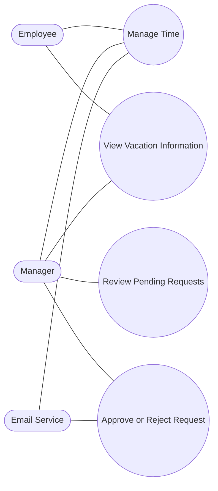
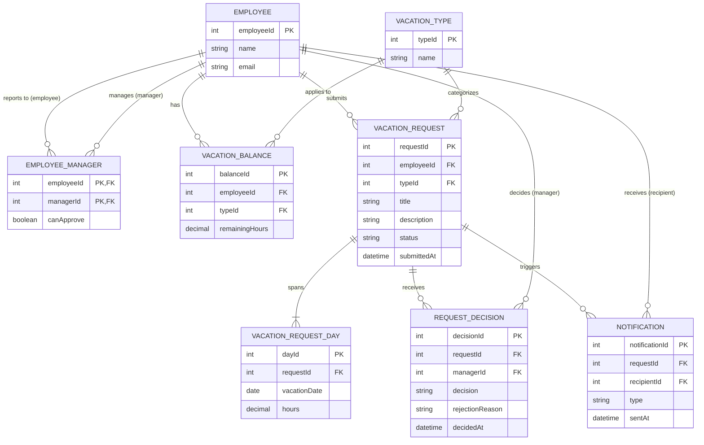
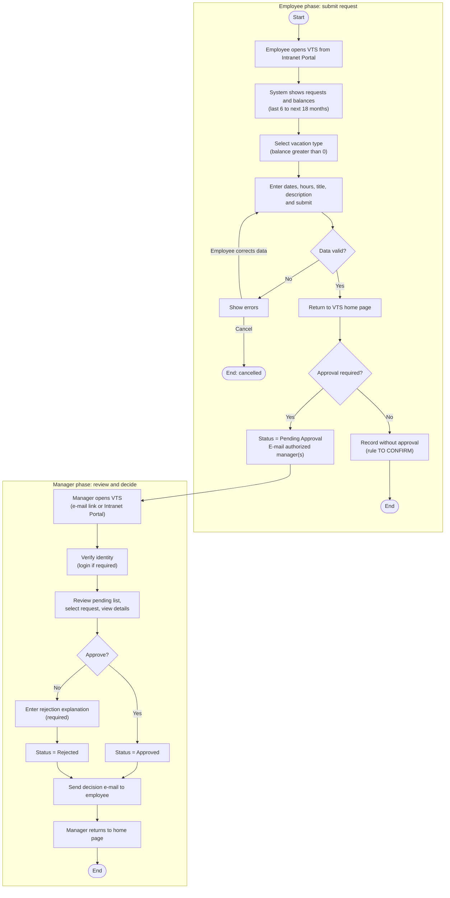
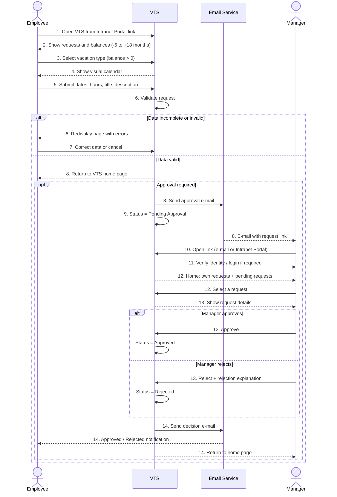

# Vacation Tracking System (VTS)

A web application, delivered as an extension of the company Intranet, for managing and tracking employee vacations: employees submit requests, authorized managers review and decide, and everyone gets visibility into vacation balances and request status.

> **Note on conventions:** items marked **TO CONFIRM** are inferred from the scenario and must be validated against the original case study before being treated as final requirements.

## Table of Contents

1. [Vision](#1-vision)
2. [System Requirements](#2-system-requirements)
3. [Domain (Problem Definition)](#3-domain-problem-definition)
4. [Actors](#4-actors)
5. [Use Cases](#5-use-cases)
6. [Entities (Data Model)](#6-entities-data-model)
7. [Flowchart (System Flow)](#7-flowchart-system-flow)
8. [Sequence Diagram](#8-sequence-diagram)
9. [Pseudocode](#9-pseudocode)

---

## 1. Vision

### Problem

Tracking employee vacations is difficult because employees work on multiple projects and report to more than one manager. Requests, balances, and approvals are hard to follow, and coordination between employees and managers is slow.

### Target Users

- **Employees**
- **Managers**

### Proposed Solution

A **web application** (the VTS) that lets employees request vacations and view their balances, and lets authorized managers review, approve, or reject requests, with e-mail notifications at each step.

### Business Value

- Better visibility into vacation balances and requests.
- Easier coordination between employees and managers.
- A single, consistent place to record decisions and request status.

---

## 2. System Requirements

### Functional Requirements

**A. Employee: vacation request management**

| ID | Requirement |
|----|-------------|
| FR-01 | **View Vacation Information:** the system shall show the employee their requests and vacation balances, covering the last 6 months and up to 18 months into the future. |
| FR-02 | **Select Vacation Category:** the system shall let the employee choose only a vacation type with a positive balance. |
| FR-03 | **Specify Vacation Dates and Hours:** the system shall let the employee select one or more days and the hours per day, with a visual calendar to help choose and compare dates. |
| FR-04 | **Enter Request Details:** the system shall let the employee enter a short title and a description of no more than one paragraph. |
| FR-05 | **Validate Request:** the system shall verify that the data is complete and valid before accepting the request. |
| FR-06 | **Display Validation Errors:** if the data is incomplete or invalid, the system shall redisplay the page and identify and explain the errors. |
| FR-07 | **Edit or Cancel Request:** the system shall let the employee correct the request data or cancel the request. |
| FR-08 | **Submit Vacation Request:** the system shall allow submission once the request passes validation. |

**B. Request processing**

| ID | Requirement |
|----|-------------|
| FR-09 | **Set Request Status:** on submission, the system shall set the request to *Pending Approval* if manager approval is required. |
| FR-10 | **Notify Authorized Manager(s):** if approval is required, the system shall e-mail the manager(s) authorized to approve. |
| FR-11 | **Access Request Through Portal or Email:** the system shall let the manager reach the VTS through a link in the e-mail, or by logging in to the Intranet and navigating to the system. |
| FR-20 | **Handle Requests Not Requiring Approval:** if a request does not require approval, the system shall record it without the *Pending Approval* state, with the resulting status defined by the approved business rule. **TO CONFIRM** |

**C. Manager: review and decision**

| ID | Requirement |
|----|-------------|
| FR-12 | **View Pending Requests:** the system shall show the manager a separate section with pending requests from their direct reports. |
| FR-13 | **Review Request Details:** the system shall let the manager select each request individually and view its details. |
| FR-14 | **Approve Request:** the system shall let an authorized manager approve a request. |
| FR-15 | **Reject Request:** the system shall let an authorized manager reject a request. |
| FR-16 | **Provide Rejection Explanation:** the system shall require the manager to enter an explanation when rejecting. |
| FR-17 | **Record Decision and Update Status:** the system shall record the decision and set the status to *Approved* or *Rejected*. |
| FR-18 | **Notify Employee of Decision:** the system shall e-mail the employee with the approval or rejection. |
| FR-19 | **Return Manager to Home Page:** after the decision is submitted, the system shall return the manager to the home page, where they can review other requests, submit their own, or leave the system. |
| FR-21 | **Update Vacation Balance:** the system shall update the balance on approval and restore it on rejection or cancellation, per company policy. **TO CONFIRM** |
| FR-22 | **Prevent Conflicting Decisions:** the system shall not allow a decision on a request that has already been decided. **TO CONFIRM** |

### Non-Functional Requirements

| ID | Category | Requirement |
|----|----------|-------------|
| NFR-01 | Security | Access to the system shall require authentication and appropriate authorization, performed through the existing Intranet Portal framework. |

The scenario does not specify measurable targets for privacy, performance, availability, or reliability. These are tracked as open questions below rather than invented as requirements.

### Constraints

| ID | Constraint | Description |
|----|------------|-------------|
| C-01 | Web application as an extension of the existing Intranet | The company chose to deliver the functionality as a web application that extends the current Intranet, so integration with the existing environment must be respected. |
| C-02 | Existing Portal framework | The scenario assumes the Portal framework authenticates users, which may become an architectural constraint if the system must rely on it rather than replace it. |

#### Business rules

- Only vacation types with a positive balance can be selected.
- The request description is limited to one paragraph.
- A rejection must include an explanation.
- Only an authorized manager can approve or reject a request.

#### Assumptions

- Employee data and employee-to-manager relationships are available to the system.
- Vacation balances are up to date before a request is submitted.
- An e-mail service is available.
- A known policy defines vacation types and balance calculation rules.
- Authorized manager(s) can be determined for each employee.

#### Open questions

| ID | Question |
|----|----------|
| Q-01 | With multiple authorized managers, is one approval enough or are all required? What happens on conflicting decisions? |
| Q-02 | What is the status of a request that does not require approval, and what makes it so? |
| Q-03 | Is the balance deducted on submission or on approval, and restored on rejection or cancellation? |
| Q-04 to Q-07 | Privacy and data retention, performance, availability, and reliability targets. |

---

## 3. Domain (Problem Definition)

The domain is **employee time-off management inside a company**. Employees hold balances of different vacation types, request time off for specific days and hours, and managers decide on those requests.

### Key concepts

| Concept | Meaning |
|---------|---------|
| **Employee** | A person who holds vacation balances and can submit requests. Managers are also employees. |
| **Manager** | An employee authorized to approve or reject requests of the employees they manage. An employee may have more than one manager. |
| **Vacation Type** | A category of leave (for example annual leave) with its own balance. |
| **Vacation Balance** | The remaining hours an employee has for a vacation type. |
| **Vacation Request** | A request for one or more days, with hours per day, a title, and a description. |
| **Request Status** | *Pending Approval*, *Approved*, or *Rejected*. |
| **Decision** | A manager's approval or rejection, with a mandatory explanation on rejection. |
| **Notification** | An e-mail sent to the manager(s) on submission and to the employee on decision. |

### Scope

- **In scope:** viewing balances and requests, submitting and validating requests, notifying managers, reviewing and deciding, notifying employees.
- **Out of scope (not specified):** payroll integration, reporting, and detailed vacation policy rules.

---

## 4. Actors

| Actor | Type | Responsibilities |
|-------|------|------------------|
| **Employee** | Primary | Views requests and balances, selects vacation type, enters dates, hours, title, and description, corrects or cancels, and submits the request. |
| **Manager (Authorized Manager)** | Primary | Receives the notification, opens the VTS, reviews pending requests, approves or rejects with an explanation. Also acts as an Employee for their own requests. |
| **Email Service** | Secondary | Sends the approval-request e-mail to managers and the decision e-mail to the employee. |
| **Intranet Portal / Authentication** | Secondary | Authenticates users and hosts the VTS as an Intranet extension. |

> Actors are roles, not people: the same person can play both Employee and Manager.

---

## 5. Use Cases



| ID | Use Case | Primary Actor | Summary |
|----|----------|---------------|---------|
| UC-01 | **Manage Time** | Employee | Submit a new vacation request and follow it through review until the decision. |
| UC-02 | View Vacation Information | Employee, Manager | See requests and balances for the last 6 to the next 18 months. |
| UC-03 | Review Pending Requests | Manager | See and open the pending requests of direct reports. |
| UC-04 | Approve or Reject Request | Manager | Decide on a request, with a mandatory explanation on rejection. |

### UC-01: Manage Time

| Item | Description |
|------|-------------|
| **Use case name** | Manage Time |
| **Actor** | Employee (primary); the Manager participates in review and decision |
| **Goal** | The employee wishes to submit a new request for vacation time. |
| **Preconditions** | The employee is authenticated through the Portal, the system knows their identity, and they are allowed to manage their own vacation requests. |

**Main flow (optimistic):**

1. The employee opens the VTS through a link in the Intranet Portal.
2. The system shows current and past requests and remaining balances for the last 6 months up to 18 months ahead.
3. The employee selects a vacation type with a balance greater than zero.
4. The system asks for dates and hours and provides a visual calendar.
5. The employee enters the dates, hours per day, a short title, and a description, then submits.
6. The system validates the data (see alternate flow A1 on failure).
7. When valid, the employee returns to the VTS home page.
8. If approval is required, the system immediately e-mails the authorized manager(s).
9. The request is set to *Pending Approval*.
10. The manager opens the request through the e-mail link or by logging in to the Intranet and navigating to the VTS.
11. The system may ask the manager to authenticate before granting access.
12. The manager's home page shows their own requests and balances and a separate section of pending requests from direct reports. The manager selects one request.
13. The system shows the details. The manager approves (status becomes *Approved*) or rejects with a required explanation (status becomes *Rejected*).
14. The system e-mails the employee with the decision and returns the manager to the home page, where they can review more requests, submit their own, or exit.

**Alternate flows (pragmatic):**

| ID | Condition | Behavior |
|----|-----------|----------|
| A1 | Data is incomplete, invalid, or fails validation (step 6) | The system redisplays the page with the errors identified and explained. The employee corrects the data or cancels the request. |
| A2 | Manager rejects (step 13) | An explanation is mandatory before the decision is recorded. |
| A3 | Request does not require approval (step 8) | Recorded without *Pending Approval*. **TO CONFIRM** (Q-02) |
| A4 | Request already decided | The system shows the current status and does not allow a second decision. **TO CONFIRM** (Q-01) |

---

## 6. Entities (Data Model)



| Entity | Purpose |
|--------|---------|
| **Employee** | A person in the company; managers are employees too. |
| **EmployeeManager** | Many-to-many link between an employee and their managers, with an approval flag. |
| **VacationType** | A category of leave. |
| **VacationBalance** | Remaining hours of a vacation type for an employee. |
| **VacationRequest** | The request; `status` is one of `PENDING_APPROVAL`, `APPROVED`, `REJECTED`. |
| **VacationRequestDay** | One day of a request with the hours requested for that day. |
| **RequestDecision** | A manager's decision, with a required `rejectionReason` when rejecting. |
| **Notification** | An e-mail sent to a manager (approval request) or an employee (decision). |

> `EmployeeManager`, `RequestDecision`, and `Notification` are derived from the requirements (multiple managers, recording decisions and explanations, e-mail notifications) rather than stated explicitly in the scenario.

---

## 7. Flowchart (System Flow)



---

## 8. Sequence Diagram



---

## 9. Pseudocode

Lines marked `TO CONFIRM` are assumptions that need validation against the case study.

### Main procedure

```text
PROCEDURE ManageTime(employee)
  REQUIRE employee.isAuthenticated()              // precondition
  showDashboard(employee)                         // steps 1-2
  request <- createRequest(employee)              // steps 3-7
  IF request = NULL THEN RETURN                   // employee cancelled
  request.submittedAt <- now()
  IF approvalRequired(request) THEN               // step 8
    managers <- getAuthorizedManagers(employee)
    request.status <- PENDING_APPROVAL            // step 9
    saveRequest(request)
    sendEmail(managers, requestLink(request))
  ELSE
    recordWithoutApproval(request)                // TO CONFIRM (Q-02)
  END IF
END PROCEDURE
```

### Dashboard (steps 1-2)

```text
PROCEDURE showDashboard(employee)
  from <- today() - 6 MONTHS
  to   <- today() + 18 MONTHS
  requests <- findRequests(employee, from, to)
  balances <- findBalances(employee)
  display(requests, balances)
END PROCEDURE
```

### Create and validate a request (steps 3-8)

```text
FUNCTION createRequest(employee)
  types <- balances WHERE remainingHours > 0      // step 3
  type  <- employee.chooses(types)
  LOOP
    days  <- calendar.select(dates, hoursPerDay)  // steps 4-5
    title <- input(); description <- input()
    action <- employee.chooses(SUBMIT, CANCEL)
    IF action = CANCEL THEN RETURN NULL
    request <- newRequest(employee, type, days, title, description)
    errors <- validate(request)                   // step 6
    IF errors is empty THEN RETURN request        // step 8
    display(errors)                               // employee corrects (step 7)
  END LOOP
END FUNCTION

FUNCTION validate(request)
  errors <- empty list
  IF request.days is empty THEN add "dates required"
  FOR EACH day IN request.days
    IF day.hours <= 0 THEN add "hours must be positive"
  IF request.title is empty THEN add "title required"
  IF request.description has more than one paragraph
    THEN add "description too long"
  IF totalHours(request) > balance(request.type)
    THEN add "insufficient balance"               // TO CONFIRM
  RETURN errors
END FUNCTION
```

### Manager review and decision (steps 10-14)

```text
PROCEDURE reviewRequests(manager)
  authenticate(manager)                           // steps 10-11
  pending <- findRequests(status = PENDING_APPROVAL, approver = manager)
  display(ownRequests(manager), balances(manager), pending)   // step 12
  request <- manager.selects(pending)
  display(request.details)                        // step 13
  IF request.status <> PENDING_APPROVAL THEN
    display("Already decided"); RETURN            // TO CONFIRM (Q-01)
  END IF
  decision <- manager.chooses(APPROVE, REJECT)
  IF decision = APPROVE THEN
    request.status <- APPROVED
  ELSE
    reason <- manager.enterReason()               // mandatory
    WHILE reason is empty: reason <- manager.enterReason()
    request.status <- REJECTED
  END IF
  saveDecision(request, manager, decision, reason, now())
  updateBalance(request)                          // TO CONFIRM (Q-03)
  sendEmail(request.employee, decision, reason)   // step 14
  goToHomePage(manager)
END PROCEDURE
```
