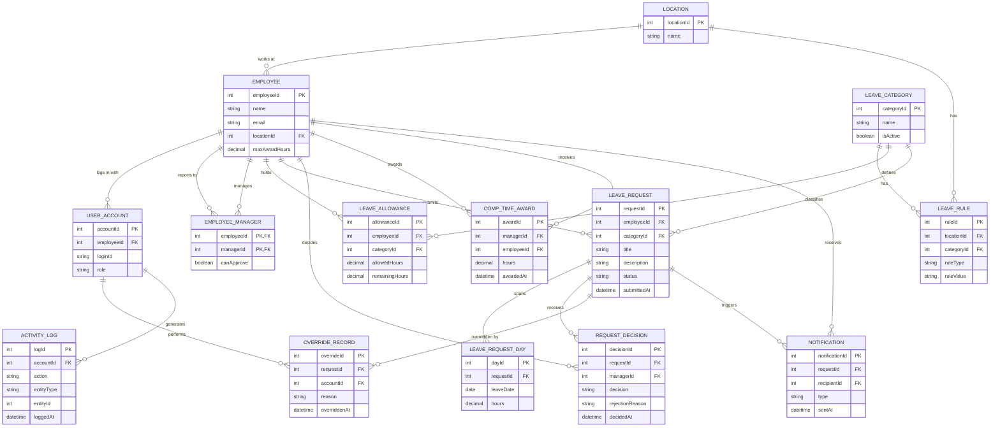
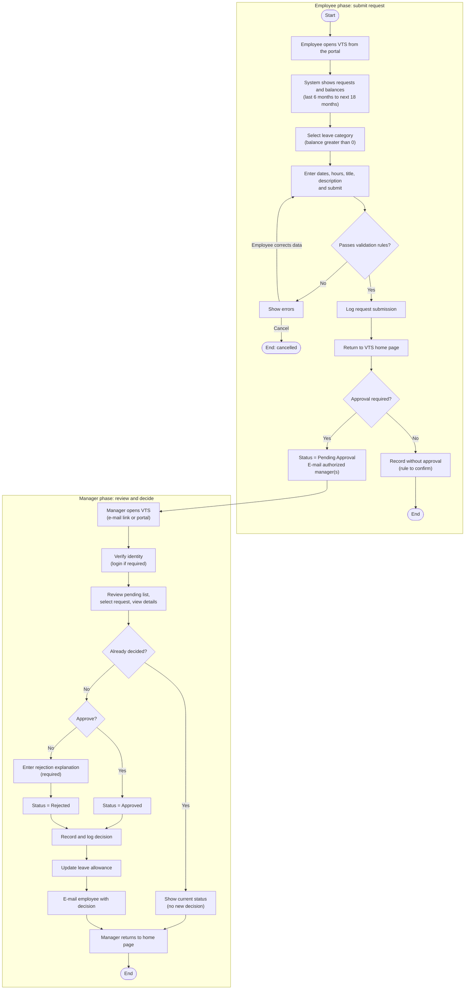
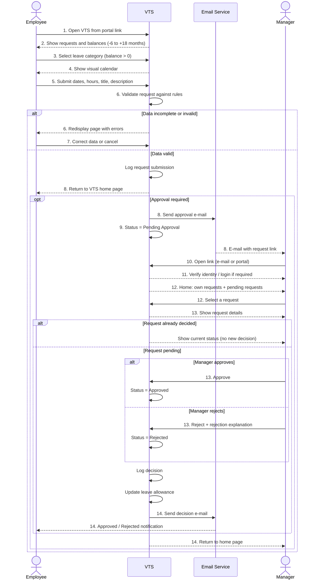

# Vacation Tracking System docs

## Index

- [**Vision**](#vision)
- [**Goals**](#goals)
- [**Domain**](#domain)
- [**Actors**](#actors)
- [**Use Cases**](#use-cases)
- [**Requirements**](#requirements)
  - [Functional Requirements](#functional-requirements)
  - [Non-Functional Requirements](#non-functional-requirements)
  - [Constraints ](#constraints)
- [**Data Model**](#data-model)
- [**Flowchart**](#flowchart)
- [**Sequence Diagram**](#sequence-diagram)
- [**Pseudocode**](#pseudocode)

---

## Vision
> Develop an intuitive and user-friendly system that allows employees to manage their vacation time, sick leave, and personal time off independently, reducing HR involvement and streamlining the overall leave management process.

## Goals
> Improve the organization's internal business processes by reducing the time, effort, and costs associated with managing vacation and leave requests, with a focus on minimizing HR workload and enhancing process efficiency.

## Domain
> The domain centers on the management of employee leave, addressing the inefficiencies of manual processes. Key challenges include ensuring compliance with company policies and employee-specific regulations, streamlining the approval workflow without disrupting business operations, and mitigating workforce shortages in critical positions. Manual tracking often causes delays, miscommunication, and operational bottlenecks, emphasizing the need for an automated solution to enhance accuracy, efficiency, and overall productivity.

## Actors

1. **Employee**: Uses the system to manage their vacation time.
2. **Manager**: Has the same abilities as an employee but can approve vacation requests for subordinates and award compensatory time within system limits.
3. **Clerk**: A member of HR with rights to view, add, or remove employee records and ensure data accuracy across HR systems. If also an employee, they use separate login IDs for HR and employee roles.
4. **System Admin**: Ensures the system runs smoothly, manages technical resources (e.g., web server, database), and archives log files.

## Use Cases
The main use cases are as follows.

- ### [**Manage Time**](./use-cases/manage-time.md): 
		Describes how employees request and view vacation time requests.

- ### [**Approve Request**](./use-cases/approve-request.md): 
		Describes how a manager responds to a subordinate’s request for vacation time. 

- ### [**Award Time**](./use-cases/award-time.md): 
		Describes how a manager can award a subordinate extra leave time (comp time).

- ### [**Edit Employee Record**](./use-cases/edit-employee-record.md):
 		Describes how an HR clerk edits an employee’s information in the system. This includes setting all the leave time allowances and the maximum time that can be awarded by the manager.

- ### [**Manage Locations**](./use-cases/manage-locations.md):
		Describes how an HR clerk manages location records and their rules.

- ### [**Manage Leave Categories**](./use-cases/manage_leave_categories.md): 
		Describes how an HR clerk manage leave categories and their rules.

- ### [**Override Leave Records**](./use-cases/override-leave-records.md): 
		Describes how an HR clerk may override any rejection of leave time requests made by the rules in the system.

- ### [**Back Up System Logs**](./use-cases/back-up-system-logs.md): 
		Describes how the system administrator backs up the system’s logs. 


## Requirements 

### Functional Requirements
1. Vacation Management 
	- Implement a rules-based system to validate and verify vacation and leave requests.
	- Allow employees to submit vacation requests up to 1.5 years in advance.
	- Provide access to vacation request history for the previous calendar year.
	- Show the employee, when they open the system, their requests and leave balances for the last 6 months up to 18 months ahead.
	- Let the employee choose only a leave category with a positive balance.
	- Let the employee select one or more days and the number of hours for each day, using a visual calendar to choose and compare dates.
	- Let the employee enter a short title and a description limited to one paragraph.
	- Validate each request before it is accepted: required data is present, hours are positive, dates are within the 1.5-year window, title and description limits are met, HR-defined location and leave category rules are satisfied, and the balance is sufficient (balance check to be confirmed).
	- Display validation errors, identifying and explaining each one, and let the employee correct the data or cancel the request.
	- Return the employee to the system home page after a successful submission.
2. Approval Workflow
	- Enable manager approval.
	- Notify manager via email of pending approval request.
	- Notify employees via email of changes to their request status.
	- Set a submitted request to Pending Approval when manager approval is required. A decided request becomes Approved or Rejected.
	- Record a request that does not require approval without the Pending Approval state. The resulting status follows the business rule (to be confirmed).
	- Support employees who have more than one manager, and notify all managers authorized to approve their requests (whether one approval or all approvals are required is to be confirmed).
	- Let the manager open a request through the link in the email, or by navigating to the system from the portal, and verify the manager's identity if required.
	- Show the manager their own requests and balances, and a separate section for pending requests from subordinates. Let the manager select each request individually and view its details.
	- Let an authorized manager approve or reject a request. A rejection requires an explanation.
	- Include the decision and, for a rejection, the explanation in the email sent to the employee.
	- Record each decision with the deciding manager and the time, and update the request status.
	- Do not allow a decision on a request that has already been decided (to be confirmed).
	- Update the employee's leave balance after a decision according to company policy (to be confirmed).
	- Return the manager to the system home page after the decision, where they can review other requests, submit their own, or leave the system.
3. Integration
	- Ensure seamless integration with existing hardware and software systems.
	- Leverage the organization's SSO portal for secure authentication.
	- Make the system accessible through a link in the organization's portal.
	- Use the organization's email service to send notifications.
4.  Logging and Overrides
	- Maintain activity logs for all transactions to ensure traceability.
	- Allow HR and system administrator to override actions, with all the overrides logged.
	- Log each request submission and each manager decision, including who performed it and when.
5. HR Flexibility
	- Enable HR to set and modify constraints on vacation requests.
	- Allow managers to award additional personal leave time within system defined limits.
	- Apply the HR-defined location and leave category rules when validating requests.
### Non-Functional Requirements
- **Useability**: The system must be intuitive, easy to navigate, and require minimal training for users. Date selection uses a visual calendar, and validation errors are clearly identified and explained.
- **Portability**: The system should function effectively on the organization's existing hardware.
- **Compatibility**: Integrate with the current HR system to retrieve and update employee data seamlessly.
- **Security**: Ensure secure authentication and data privacy through encryption and access control. Employees can access only their own requests, and managers can decide only on requests from their own subordinates.
- **Availability**: Provide 24/7 access with minimal downtime.
- **Accountability**: Log all transactions and system actions to ensure transparency and auditability.

### Constraints 
- The system must integrate with existing HR systems for employee data synchronization.
- All features must comply with the organization's IT infrastructure and policies.
- Authentication must go through the organization's SSO portal, and users reach the system through the organization's portal.
- Notifications depend on the organization's email service being available.

---

## Data Model

The model covers the entities needed by the use cases above. The core entities for **Manage Time** are `Employee`, `LeaveCategory`, `LeaveAllowance`, `LeaveRequest`, `LeaveRequestDay`, `RequestDecision`, and `Notification`. The remaining entities support the other use cases (HR configuration, overrides, comp time, and logging).



| Entity | Purpose | Used by |
|--------|---------|---------|
| **Employee** | A person in the company (managers, clerks, and admins are employees too). Holds the maximum comp time a manager may award. | All |
| **UserAccount** | A login with a role (`EMPLOYEE`, `MANAGER`, `CLERK`, `ADMIN`). A clerk who is also an employee has two accounts. | Security, Overrides, Logging |
| **EmployeeManager** | Links an employee to one or more managers. | Manage Time, Approve Request |
| **Location** | A site whose leave rules apply to its employees. | Manage Locations |
| **LeaveCategory** | A kind of leave (vacation, sick leave, personal time, and so on). | Manage Leave Categories |
| **LeaveRule** | A rule per location and category, used to validate requests. | Manage Time, Manage Locations, Manage Leave Categories |
| **LeaveAllowance** | Allowed and remaining hours per employee and category. | Manage Time, Edit Employee Record |
| **LeaveRequest** | A request; `status` is `PENDING_APPROVAL`, `APPROVED`, or `REJECTED`. | Manage Time, Approve Request |
| **LeaveRequestDay** | One requested day and its hours. | Manage Time |
| **RequestDecision** | A manager's decision, with a required `rejectionReason` on rejection. | Approve Request |
| **CompTimeAward** | Extra leave awarded by a manager, within `maxAwardHours`. | Award Time |
| **OverrideRecord** | An HR or admin override of a rejection or action. | Override Leave Records |
| **Notification** | An e-mail to a manager (pending request) or an employee (status change). | Manage Time, Approve Request |
| **ActivityLog** | Traceability record for every transaction and override. | Back Up System Logs |

> `LeaveRule`, `OverrideRecord`, `CompTimeAward`, `Notification`, and `ActivityLog` are derived from the requirements text (rules-based validation, overrides, comp time, e-mail notifications, activity logs). Their exact attributes should be confirmed against the detailed use case files.

---

## Flowchart

System flow of the **Manage Time** use case, from submitting a request to the manager's decision.



---

## Sequence Diagram



---

## Pseudocode

Lines marked `TO CONFIRM` are assumptions that need validation against the detailed use case.

### Manage Time

```text
PROCEDURE ManageTime(employee)
  REQUIRE employee.isAuthenticated()
  showDashboard(employee)
  request <- createRequest(employee)
  IF request = NULL THEN RETURN
  request.submittedAt <- now()
  logActivity(employee, "SUBMIT_REQUEST", request)
  IF approvalRequired(request) THEN
    managers <- getAuthorizedManagers(employee)
    request.status <- PENDING_APPROVAL
    saveRequest(request)
    sendEmail(managers, requestLink(request))
  ELSE
    recordWithoutApproval(request)
  END IF
END PROCEDURE
```

### Show the employee dashboard

```text
PROCEDURE showDashboard(employee)
  from <- today() - 6 MONTHS
  to   <- today() + 18 MONTHS
  requests <- findRequests(employee, from, to)
  balances <- findAllowances(employee)
  display(requests, balances)
END PROCEDURE
```

### Create and validate a request

```text
FUNCTION createRequest(employee)
  categories <- allowances WHERE remainingHours > 0
  category   <- employee.chooses(categories)
  LOOP
    days  <- calendar.select(dates, hoursPerDay)
    title <- input(); description <- input()
    action <- employee.chooses(SUBMIT, CANCEL)
    IF action = CANCEL THEN RETURN NULL
    request <- newRequest(employee, category, days, title, description)
    errors <- validate(request)
    IF errors is empty THEN RETURN request
    display(errors)
  END LOOP
END FUNCTION

FUNCTION validate(request)
  errors <- empty list
  IF request.days is empty THEN add "dates required"
  FOR EACH day IN request.days
    IF day.hours <= 0 THEN add "hours must be positive"
    IF day.date > today() + 18 MONTHS THEN add "too far in advance"
  IF request.title is empty THEN add "title required"
  IF request.description has more than one paragraph
    THEN add "description too long"
  rules <- findRules(employee.location, request.category)
  FOR EACH rule IN rules
    IF NOT rule.isSatisfiedBy(request) THEN add rule.message
  IF totalHours(request) > remainingHours(request)
    THEN add "insufficient balance"
  RETURN errors
END FUNCTION
```

### Manager review and decision

```text
PROCEDURE reviewRequests(manager)
  authenticate(manager)
  pending <- findRequests(status = PENDING_APPROVAL, approver = manager)
  display(ownRequests(manager), allowances(manager), pending)
  request <- manager.selects(pending)
  display(request.details)
  IF request.status <> PENDING_APPROVAL THEN
    display("Already decided"); RETURN
  END IF
  decision <- manager.chooses(APPROVE, REJECT)
  IF decision = APPROVE THEN
    request.status <- APPROVED
  ELSE
    reason <- manager.enterReason()
    WHILE reason is empty: reason <- manager.enterReason()
    request.status <- REJECTED
  END IF
  saveDecision(request, manager, decision, reason, now())
  logActivity(manager, decision, request)
  updateAllowance(request)
  sendEmail(request.employee, decision, reason)
  goToHomePage(manager)
END PROCEDURE
```
