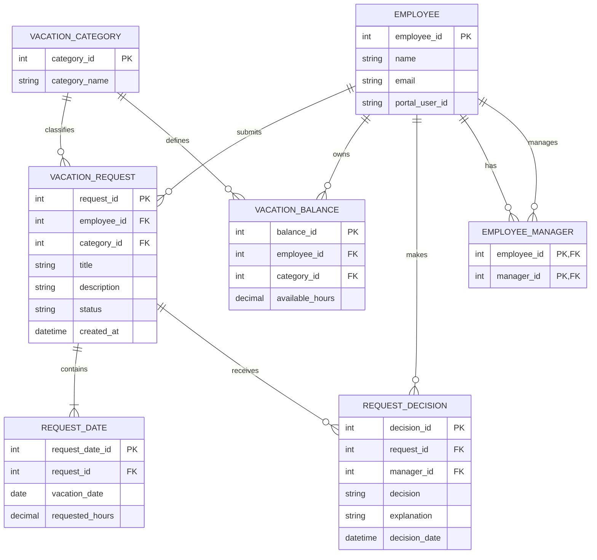
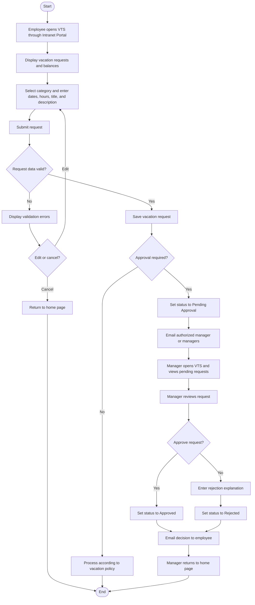
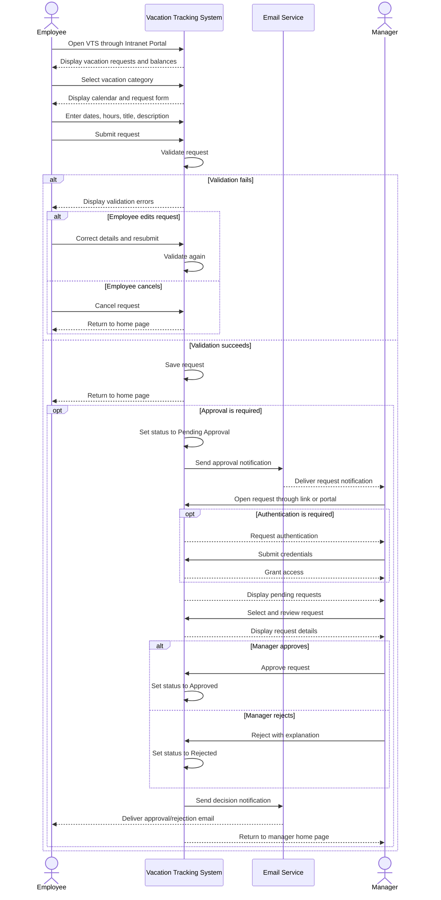

# Vacation Tracking System (VTS)

A web-based application for managing, submitting, reviewing, and tracking employee vacation requests across multiple projects and reporting relationships.

---

## 1. Vision

### 1.1 Problem
Employees may work on multiple projects and report to more than one manager. This makes it difficult to coordinate vacation requests, track available vacation balances, and identify the managers responsible for reviewing and approving requests.

### 1.2 Target Users
- **Employees:** View vacation balances and request history, submit vacation requests, and receive decisions.
- **Managers:** Review requests from authorized employees and approve or reject them.
- **System Administrators / HR Staff:** May be included in a future scope for managing employee records, vacation policies, and balances. They are not explicitly defined as actors in the current use case.

### 1.3 Proposed Solution
Develop a web-based Vacation Tracking System accessible through the organization's intranet portal. The system will allow employees to view their vacation information, submit requests, and track the request process. It will also allow authorized managers to review requests, record decisions, and notify employees through email.

### 1.4 Business Value
- Improve visibility into employee vacation balances and requests.
- Improve coordination between employees and multiple managers.
- Reduce manual communication and administrative effort.
- Provide consistent tracking of request statuses and decisions.
- Make vacation approval responsibilities clearer across projects.

---

## 2. System Requirements

### 2.1 Functional Requirements

| ID | Requirement |
|---|---|
| FR-01 | The system shall display an employee's vacation requests and balances for the previous six months through eighteen months into the future. |
| FR-02 | The system shall allow an employee to select a vacation category only when the employee has a positive balance for that category. |
| FR-03 | The system shall provide a calendar interface for selecting vacation dates. |
| FR-04 | The system shall allow the employee to specify the requested hours for each vacation date. |
| FR-05 | The system shall collect a short title and a description for each vacation request. |
| FR-06 | The system shall validate submitted request information. |
| FR-07 | If validation fails, the system shall redisplay the request form and identify the errors. |
| FR-08 | The system shall allow the employee to correct invalid information or cancel the request. |
| FR-09 | The system shall save a request after its information passes validation. |
| FR-10 | If manager approval is required, the system shall set the request status to `Pending Approval`. |
| FR-11 | The system shall email authorized manager(s) when a request requires their approval. |
| FR-12 | A manager shall be able to access a request through an email link or through the intranet portal. |
| FR-13 | The system shall display the manager's own vacation information and pending requests from employees they are authorized to manage. |
| FR-14 | The system shall allow a manager to review requests individually and view their details. |
| FR-15 | The system shall allow an authorized manager to approve a vacation request. |
| FR-16 | The system shall allow an authorized manager to reject a vacation request. |
| FR-17 | The system shall require an explanation when a manager rejects a request. |
| FR-18 | The system shall record the manager's decision and update the request status to `Approved` or `Rejected`. |
| FR-19 | The system shall email the employee to communicate the decision. |
| FR-20 | After handling a request, the manager shall be able to return to the home page and review other requests, submit a personal request, or leave the system. |

### 2.2 Non-Functional Requirements

The use case does not specify measurable targets for every quality attribute. The following are proposed requirements that should be confirmed with stakeholders.

| ID | Category | Requirement |
|---|---|---|
| NFR-01 | Security | The system shall restrict access to authenticated users with appropriate permissions. |
| NFR-02 | Privacy | Employees and managers shall only access information they are authorized to view. |
| NFR-03 | Usability | The system shall provide a clear interface for viewing vacation information and selecting dates using a calendar. |
| NFR-04 | Reliability | The system shall preserve submitted requests and recorded decisions consistently. |
| NFR-05 | Performance | Common operations shall meet response-time targets agreed upon with stakeholders. |
| NFR-06 | Availability | The system shall meet an availability target defined by the organization. |
| NFR-07 | Maintainability | The system should be structured so that its components can be maintained and updated without unnecessary impact on unrelated functionality. |

> Note: The response-time and availability targets must be defined before these requirements can be verified objectively.

### 2.3 Constraints

- **Existing Intranet Integration:** The VTS is accessed through the organization's existing intranet portal.
- **Web-Based Application:** The proposed system is a web application.
- **Portal Authentication:** The use case assumes that the employee has authenticated through the portal before accessing the VTS.
- **Authorization:** Only authorized managers should review the relevant employees' vacation requests.
- **Vacation Balance Rule:** An employee may select a vacation category only when its available balance is positive.
- **Rejection Explanation:** A manager must provide an explanation when rejecting a request.

> The vacation balance rule and rejection explanation are business rules stated in the use case. They are included here as implementation constraints as well as functional rules.

---

## 3. Domain (Problem Definition)

The Vacation Tracking System addresses the difficulty of managing employee vacation time in an organization where employees may work on multiple projects and report to multiple managers.

The system supports the following domain concepts:

- Employees and their vacation balances.
- Vacation categories.
- Vacation requests containing titles, descriptions, dates, and requested hours.
- Managers authorized to review requests.
- Approval and rejection decisions.
- Email notifications.
- Integration with the organization's intranet portal.

The system manages the request lifecycle from submission and validation to manager review and notification of the decision.

The approval policy, balance deduction rules, and processing of requests that do not require approval must be clarified with the organization before implementation.

---

## 4. Actors

### 4.1 Employee
**Type:** Primary Actor

The employee initiates the request process.

Responsibilities:
- Access the VTS through the intranet portal.
- View vacation requests and balances.
- Select a vacation category.
- Enter requested dates, hours, title, and description.
- Submit a request.
- Correct validation errors or cancel a request.
- Receive an email notification of the manager's decision.

### 4.2 Manager
**Type:** Supporting Actor in the request submission flow; primary actor for the review interaction.

Responsibilities:
- Access the VTS.
- View pending requests from authorized employees.
- Review individual requests.
- Approve requests.
- Reject requests and provide an explanation.
- Return to the home page after handling a request.

### 4.3 Email Service
**Type:** External Supporting System

Responsibilities:
- Send approval notifications to authorized managers.
- Send decision notifications to employees.

The use case specifies email notifications but does not define the technical email implementation. Therefore, the Email Service is modeled as an external participant for diagramming purposes.

### Systems That Are Not Necessarily Actors
- **VTS:** The system being designed, represented as a system lifeline rather than an external actor.
- **Intranet Portal:** The access point to the VTS. It can be modeled separately if the diagram includes interactions with the portal itself.
- **Database:** An internal implementation component, not an actor in the original use case.
- **Authentication Service:** Not explicitly defined as a separate external actor in the use case.

---

## 5. Use Cases

### 5.1 Use Case List

| Use Case | Actor | Description |
|---|---|---|
| View Vacation Information | Employee | View vacation requests and balances. |
| Submit Vacation Request | Employee | Create and submit a new vacation request. |
| Correct or Cancel Request | Employee | Correct validation errors or cancel a request before successful submission. |
| View Pending Requests | Manager | View requests awaiting the manager's review. |
| Review Vacation Request | Manager | View the details of an individual request. |
| Approve Vacation Request | Manager | Approve a request and record the decision. |
| Reject Vacation Request | Manager | Reject a request and provide an explanation. |
| Notify Manager | Email Service | Deliver a notification when approval is required. |
| Notify Employee | Email Service | Deliver the final approval or rejection notification. |
| Manage Time | Employee and Manager | Covers the request lifecycle, including submission, validation, review, decision, and notification. |

### 5.2 Use Case: Manage Time

**Use Case Name:** Manage Time

**Primary Actor:** Employee

**Supporting Actor:** Manager

**Goal:** The employee submits a new vacation request.

#### Preconditions
- The employee is authenticated through the intranet portal.
- The employee has permission to manage their own vacation requests.

#### Main Flow
1. The employee opens the VTS through the intranet portal.
2. The system displays vacation requests and balances covering the previous six months through eighteen months into the future.
3. The employee selects a vacation category with a positive balance.
4. The system displays a calendar and request form.
5. The employee enters the requested dates, hours for each date, a title, and a description.
6. The employee submits the request.
7. The system validates the submitted information.
8. If validation fails, the system displays the errors and allows the employee to correct the information or cancel the request.
9. If validation succeeds, the system saves the request and returns the employee to the home page.
10. If approval is required, the system sets the status to `Pending Approval` and emails the authorized manager(s).
11. The manager opens the request through the email link or the intranet portal and authenticates if required.
12. The system displays the manager's vacation information and pending requests from authorized employees.
13. The manager selects and reviews a request.
14. The manager approves or rejects the request. A rejection requires an explanation.
15. The system records the decision and changes the status to `Approved` or `Rejected`.
16. The system emails the employee with the decision.
17. The manager returns to the home page.

#### Alternative Flows

**A. Validation Failure**
1. The system identifies invalid or missing information.
2. The system redisplays the form with errors.
3. The employee edits and resubmits the request, or cancels it.

**B. Request Approved**
1. The manager approves the request.
2. The system records the decision.
3. The status becomes `Approved`.
4. The system emails the employee.

**C. Request Rejected**
1. The manager rejects the request.
2. The manager provides an explanation.
3. The system records the decision.
4. The status becomes `Rejected`.
5. The system emails the employee.

**D. Approval Not Required**
The use case indicates that some requests may not require manager approval. The exact processing and final status for this path are not specified and must be defined by the organization.

#### Postconditions
- A valid request is recorded.
- If approval is required, the request enters `Pending Approval`.
- After a manager's decision, the status and decision are recorded.
- The employee is notified of the decision by email.

---

## 6. Entities (Data Model)

The following is a proposed logical data model derived from the use case. Attribute types and implementation details should be refined during database design.

### 6.1 Employee

Represents employees and managers.

| Attribute | Description |
|---|---|
| `employee_id` (PK) | Unique employee identifier |
| `name` | Employee's name |
| `email` | Employee's email address |
| `portal_user_id` | Identifier associated with the intranet account |

### 6.2 VacationCategory

Represents available vacation categories.

| Attribute | Description |
|---|---|
| `category_id` (PK) | Unique category identifier |
| `category_name` | Name of the vacation category |

### 6.3 VacationBalance

Stores the available balance for an employee and a vacation category.

| Attribute | Description |
|---|---|
| `balance_id` (PK) | Unique balance record identifier |
| `employee_id` (FK) | References Employee |
| `category_id` (FK) | References VacationCategory |
| `available_hours` | Available vacation hours |

### 6.4 VacationRequest

Represents a vacation request submitted by an employee.

| Attribute | Description |
|---|---|
| `request_id` (PK) | Unique request identifier |
| `employee_id` (FK) | Employee who submitted the request |
| `category_id` (FK) | Requested vacation category |
| `title` | Short request title |
| `description` | Request description |
| `status` | Current request status |
| `created_at` | Request submission timestamp |

Possible statuses defined by the current use case:
- `Pending Approval`
- `Approved`
- `Rejected`

Additional statuses should only be introduced when the business rules require them.

### 6.5 RequestDate

Stores each date and the number of hours requested for that date.

| Attribute | Description |
|---|---|
| `request_date_id` (PK) | Unique record identifier |
| `request_id` (FK) | References VacationRequest |
| `vacation_date` | Requested vacation date |
| `requested_hours` | Number of hours requested on that date |

### 6.6 RequestDecision

Stores a manager's decision on a request.

| Attribute | Description |
|---|---|
| `decision_id` (PK) | Unique decision identifier |
| `request_id` (FK) | References VacationRequest |
| `manager_id` (FK) | References Employee for the manager |
| `decision` | `Approved` or `Rejected` |
| `explanation` | Explanation required for rejection |
| `decision_date` | Date and time of the decision |

Multiple decision records may be required if the confirmed approval policy requires several managers to review the same request.

### 6.7 EmployeeManager

Represents the many-to-many relationship between employees and managers.

| Attribute | Description |
|---|---|
| `employee_id` (PK, FK) | References the employee |
| `manager_id` (PK, FK) | References a manager represented by an Employee record |

This relationship is needed because an employee may report to more than one manager.

### 6.8 Entity Relationship Diagram



### 6.9 Main Relationships
- One employee can submit many vacation requests.
- One vacation category can be associated with many requests.
- One employee can have multiple vacation balance records.
- One vacation request can contain multiple requested dates.
- One request can receive one or more decision records, depending on the approval policy.
- An employee can report to multiple managers, and a manager can manage multiple employees.

---

## 7. Flowchart (System Flow)



**Note:** The path for requests that do not require approval is left at a policy-processing step because the original use case does not define the exact status or processing rules for that path.

---

## 8. Sequence Diagram



---

## 9. Pseudocode

### 9.1 Submit Vacation Request

```text
PROCEDURE SubmitVacationRequest(employee)

    DISPLAY employee's vacation requests and balances

    INPUT vacation category

    IF employee's balance for category <= 0 THEN
        DISPLAY "No available balance for this category"
        RETURN
    END IF

    REPEAT
        DISPLAY calendar and request form

        INPUT requested dates
        INPUT requested hours for each date
        INPUT request title
        INPUT request description

        VALIDATE request data

        IF request data is invalid THEN
            DISPLAY validation errors
            INPUT employee choice: Edit or Cancel

            IF choice = Cancel THEN
                RETURN to home page
                EXIT PROCEDURE
            END IF
        END IF

    UNTIL request data is valid

    SAVE vacation request

    IF approval is required THEN
        SET request status = "Pending Approval"

        FIND authorized manager(s)
        SEND approval notification to manager(s)
    ELSE
        PROCESS according to the organization's vacation policy
    END IF

    RETURN employee to home page

END PROCEDURE
```

### 9.2 Review Vacation Request

```text
PROCEDURE ReviewVacationRequest(manager, request)

    VERIFY manager is authorized to review request

    DISPLAY manager's vacation information
    DISPLAY pending requests from authorized employees

    SELECT request
    DISPLAY request details

    INPUT manager decision

    IF decision = "Approve" THEN

        SET request status = "Approved"

    ELSE IF decision = "Reject" THEN

        REPEAT
            INPUT rejection explanation
        UNTIL explanation is not empty

        SET request status = "Rejected"

    END IF

    SAVE manager decision and request status

    SEND decision notification to employee

    RETURN manager to home page

END PROCEDURE
```

---

## Open Questions Before Implementation

The following decisions require confirmation from the organization:

1. What happens to requests that do not require manager approval?
2. Does one manager make the final decision after consulting other managers, or must multiple managers approve the request?
3. When should vacation balances be reduced or restored?
4. What validation rules apply to working days, working hours, overlapping requests, and available balances?
5. What are the required security, privacy, performance, and availability targets?
6. Which existing company systems must integrate with the VTS?

These points are documented as open questions rather than assumed behavior.
